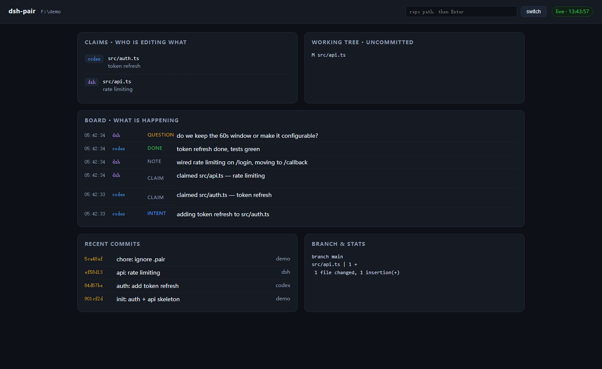

# pair

**Two coding agents. One repository. No collisions.**

[](https://github.com/cfule638-ui/dsh-pair/actions/workflows/ci.yml)
[](LICENSE)
[](package.json)
[](package.json)

`pair` gives a pair of AI coding agents (Codex + Claude Code, DSH + Codex, anything that can run a shell or speak MCP) a shared working surface inside a single git checkout:

- **claims** — "I'm editing these files", enforced, so the other agent backs off instead of silently overwriting you
- **board** — an append-only log of intent: what I'm doing, what I finished, where I'm stuck
- **diff** — git is the source of truth for *what actually changed*; no proprietary state to trust
- **panel** — a zero-dependency local dashboard so you can watch both agents work

55 KB. Zero dependencies. Node ≥ 20. No daemon, no database, no build step.

```bash
npx github:cfule638-ui/dsh-pair status --repo=~/code/my-project
```



---

## The problem

Two agents in one repo fail in three predictable ways:

| Failure | What it looks like |
|---|---|
| **Blindness** | Neither knows which files the other touched — until a test breaks |
| **Collision** | Both write `auth.ts`; the second save erases the first, silently |
| **Drift** | Nobody knows what the other is doing or where it got stuck |

`pair` fixes each with the smallest possible mechanism:

```
git status / git diff   → what changed (truth, auditable, already there)
.pair/claims.json       → who is editing what (advisory lock, 2h TTL)
.pair/board.jsonl       → who is doing what (append-only, agent-readable)
```

`.pair/` is added to `.gitignore` automatically — your repo stays clean.

## Install

```bash
git clone https://github.com/cfule638-ui/dsh-pair.git ~/dsh-tools/pair
node ~/dsh-tools/pair/src/cli.mjs status --repo=~/code/my-project
```

Or as a one-off, straight from GitHub:

```bash
npx github:cfule638-ui/dsh-pair status --repo=~/code/my-project
```

## Wire it into Codex

```bash
codex mcp add pair --env PAIR_AGENT=codex -- node ~/dsh-tools/pair/src/server.mjs
codex mcp list
```

That writes to `~/.codex/config.toml`:

```toml
[mcp_servers.pair]
command = "node"
args = ["/home/you/dsh-tools/pair/src/server.mjs"]
env = { PAIR_AGENT = "codex" }
startup_timeout_sec = 30
tool_timeout_sec = 120
```

Any other MCP client (Claude Code, Cursor, Windsurf, a hand-rolled agent) takes the same stdio server.

## Wire it into anything else (shell-only agents)

Some hosts can't load MCP servers reliably (the DSH desktop app, for one). Every tool has a CLI twin over the same state:

```bash
PAIR_AGENT=dsh node ~/dsh-tools/pair/src/cli.mjs status  --repo=~/code/my-project
PAIR_AGENT=dsh node ~/dsh-tools/pair/src/cli.mjs claim   src/auth.ts --note="token refresh" --repo=...
PAIR_AGENT=dsh node ~/dsh-tools/pair/src/cli.mjs say     "auth is done" --kind=done --repo=...
PAIR_AGENT=dsh node ~/dsh-tools/pair/src/cli.mjs diff    HEAD~2..HEAD --repo=...
```

Agents never need to know which transport you picked — the state is shared.

## The six tools

| Tool | Purpose |
|---|---|
| `pair_status` | One shot: uncommitted work, recent commits, the other agent's claims, latest board entries |
| `pair_claim` | "These paths are mine" — rejected if the other agent holds an overlapping path |
| `pair_release` | Done with them |
| `pair_diff` | Real line-by-line diff; `rev` accepts `HEAD~2..HEAD` |
| `pair_say` | Post intent: `note` / `intent` / `done` / `question` / `blocker` |
| `pair_board` | Read the log; `since` for incremental polls, `only_other` to skip your own noise |

Every tool accepts an optional `repo` argument — useful when a long-running host spawns the server from its own directory instead of your project.

Claims are prefix-aware: `src/auth` conflicts with `src/auth/token.js`, and expire after two hours so a crashed agent can't hold a file hostage. All read-modify-write cycles go through a cross-process lock, so two agents claiming in the same millisecond don't lose a claim.

## Watch it happen

```bash
node src/cli.mjs ui --repo=~/code/my-project --port=8787
# → http://127.0.0.1:8787
```

Dark dashboard, 2-second polling: claims, dirty tree, board, recent commits, branch stats. Dead simple HTML served by `node:http`, no build, no framework.

## Teach the agents the rules

Run this once per project:

```bash
node src/cli.mjs init --repo=~/code/my-project
```

It appends a marked block to `AGENTS.md` (which Codex, Claude Code and most harnesses read), giving each agent the six rules: check before you start, claim before you edit, back off on a conflict, announce when a chunk is done, diff before you call it finished, escalate when you disagree.

The block is idempotent and delimited by `<!-- pair:begin -->` / `<!-- pair:end -->`, so you can keep editing around it.

## Design notes

**Why one working directory instead of a worktree per agent?** Worktrees are the right tool when agents work on *separate* tasks that merge later. They are the wrong tool when you want the agents to see each other's work *as it happens* — the whole point of pairing. Same tree means a collision is a visible claim conflict, not a merge conflict three hours later.

**Why not a server with a database?** Because the expensive thing to get right is the protocol, not the storage. A JSON file plus an append-only log is inspectable with `cat`, survives a crash, and needs no migration path. If this ever needs SQLite, the interfaces won't change.

**What it deliberately does not do:** schedule agents, route messages between models, run your tests, or decide who is right. It is a coordination surface, not an orchestrator.

## Prior art

The mechanism is not novel — several projects coordinate parallel agents. Worth reading:

- [naw103/foremerge](https://github.com/naw103/foremerge) — git-level coordination protocol, Rust + SQLite, worktrees, intent-conflict detection
- [leaf76/session-collab-mcp](https://github.com/leaf76/session-collab-mcp) — WIP registry with declare/check/release, Claude Code focused
- [JoahanMorales/upiixia-agentic-kit](https://github.com/JoahanMorales/upiixia-agentic-kit) — claims + zero-server bash/git setup

`pair` differs in shape rather than in idea: a single dependency-free file, one shared working tree instead of worktrees, a built-in panel, and both MCP and CLI transports so a host that cannot load MCP still participates.

## Limitations

- Claims are cooperative, not enforced by the OS. An agent that writes without claiming will not be stopped — `pair_status` will show it, that's all.
- Both agents share one tree, so an unclaimed overwrite is silent. That is the cost of shared visibility; claims are the mitigation.
- `.pair/` is local. For cross-machine work, push branches and open PRs.

## License

MIT — see [LICENSE](LICENSE). 中文说明见 [README.zh-CN.md](README.zh-CN.md).